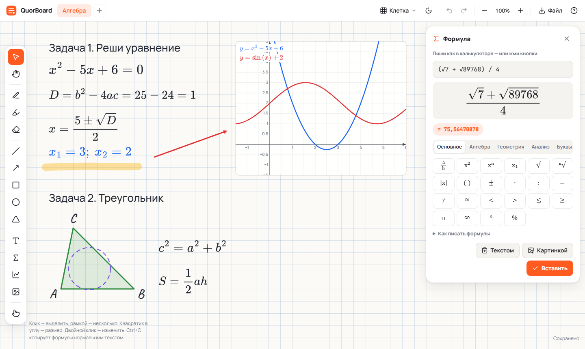

# QuorBoard — тетрадь для учёбы

Тетрадь в клетку для онлайн-учёбы за компьютером: формулы, графики функций, геометрия и распознавание того, что написал от руки. Работает прямо в браузере, без регистрации и установки.

**Открыть:** https://quorvox.github.io/quor-board/



## Что умеет

- **Формулы с клавиатуры** — пишешь как в калькуляторе: `(√7 + √89768) / 4`, `x^2 - 5x + 6 = 0`, `log_2(8)`, `system(x+y=5; x-y=1)`. Кнопки для корней, дробей, степеней, систем, тригонометрии. Поставь `=` в конце — посчитает ответ.
- **Копирование нормальным текстом** — формулы копируются как `(√7 + √89768) / 4`, а не LaTeX. LaTeX из нейросети при вставке сам превращается в формулу.
- **Рукописное → текст** — написал мышкой `√7 + 5 =` или `log 5`, выделил, `Ctrl+C` — в буфере текст. Кнопка «Распознать» даёт поправить и заменить каракули ровной формулой. Распознавание работает без интернета.
- **Ровные фигуры** — рисуешь ручкой и держишь мышь в конце: кривая линия станет прямой, круг — кругом, треугольник — треугольником.
- **Графики функций** — `y = x^2 - 3`, `sin(x)`, `1/x`, `log_2(x)`, несколько функций на одном графике.
- **Геометрия** — отрезки, векторы, циркуль, многоугольники; точки липнут к клеткам, длина показывается в клетках.
- **Фон** — клетка, линейка, точки, координатная плоскость; светлая тетрадь и тёмная доска.
- **Для занятий по видео** — указка с тающим следом, вставка скриншота задания через `Ctrl+V`.
- **Сохранение** — автоматически в браузере; экспорт листа в PNG, всех листов в PDF, тетради в файл `.qboard`.

## Горячие клавиши

Работают в любой раскладке — русской, английской, немецкой (`P` = `З`).

| Клавиша | Что делает |
|---|---|
| `V` `P` `M` `E` | выделение, ручка, маркер, ластик |
| `L` `A` `R` `C` `G` | отрезок, стрелка, прямоугольник, окружность, многоугольник |
| `T` `F` `K` | текст, формула, график |
| `U` | указка |
| `Ctrl+Z` / `Ctrl+Y` | отменить / вернуть |
| `Ctrl+C` | копировать (формулы — текстом) |
| `Ctrl+Shift+C` | копировать картинкой |
| `?` | все подсказки |

## Приватность

Тетрадь хранится только в твоём браузере (IndexedDB) — на сервер ничего не отправляется. Шрифты подключены через Bunny Fonts (без передачи данных в Google), библиотеки — с проверкой целостности (SRI).

## Запуск у себя

Скачать репозиторий и открыть `index.html` в браузере. Или локальный сервер:

```
python -m http.server 8000
```

## Как устроено

Чистый HTML, CSS и JavaScript, без сборки.

- `js/mathparse.js` — разбор школьной записи → LaTeX, вычисление функций для графиков, обратный перевод в текст
- `js/recognize.js` — распознавание рукописного: облако точек ($P) + правила для дробей, корней, степеней и словарь (log, sin, lim…)
- `js/render.js`, `js/tools.js` — холст и инструменты
- `js/panels.js`, `js/ui.js` — панели формулы и графика, меню, горячие клавиши

Формулы рисует [MathJax 3](https://www.mathjax.org/), иконки — [Lucide](https://lucide.dev/).

---

Сделано командой [Quorvox_team](https://quorvox.github.io/).
